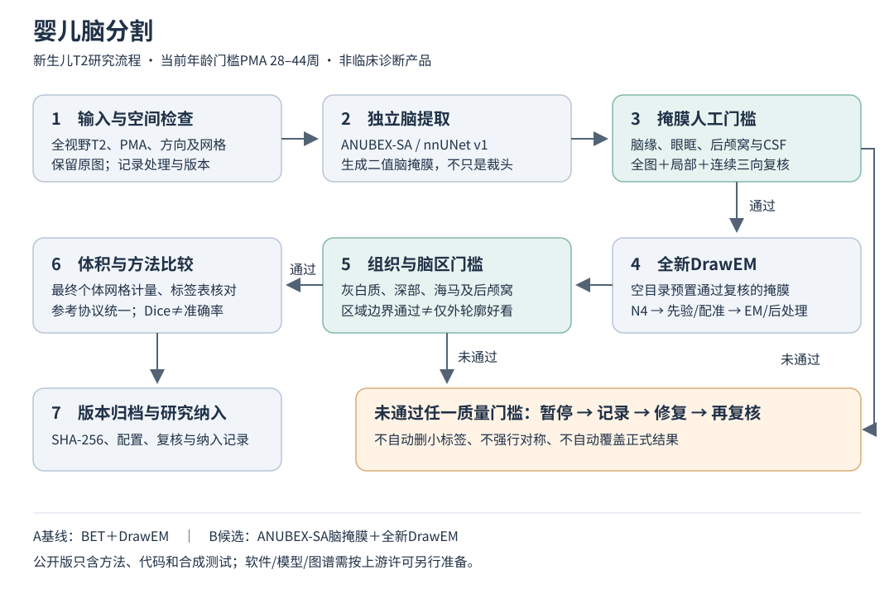
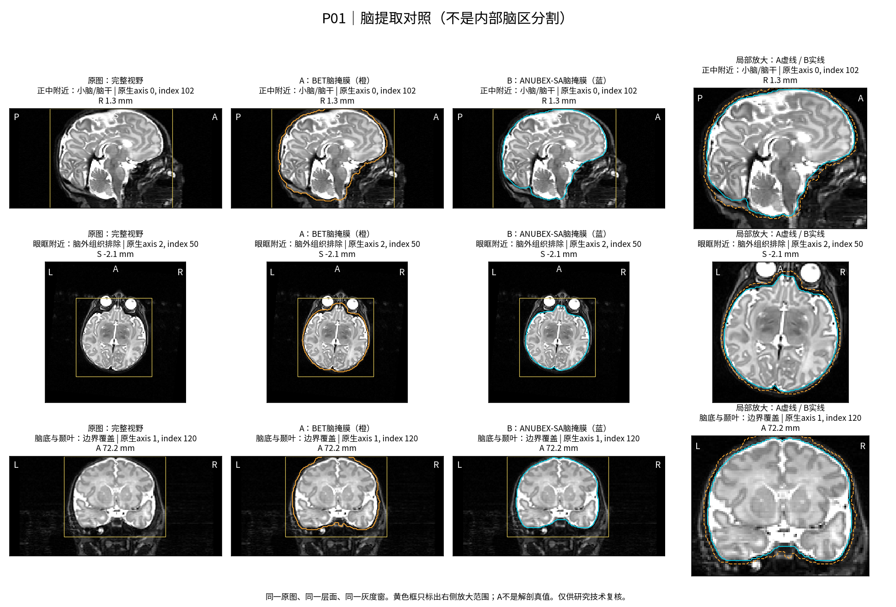
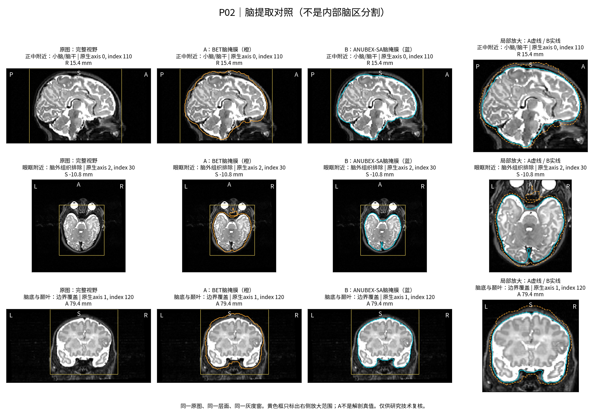

# 婴儿脑分割

Infant Brain Segmentation · T2脑提取、脑区分割、质量复核与体积计算。

本项目整理一条可检查、可追溯的研究流程：**独立脑提取 → 掩膜复核 → 全新DrawEM → 脑区复核 → 个体空间体积计算**。标题使用“婴儿脑分割”，但当前方法主要面向新生儿，年龄模板门槛为扫描时胎龄（PMA）28–44周；不能直接推断适用于全部婴儿月龄或所有异常解剖。

公开仓库含方法文档、自编核查代码、合成测试，以及经许可展示的[公开M-CRIB数据派生对照图](MCRIB_DEMO.md)；不含本地临床患者影像、医生勾画、临床病例编号、临床结果、历史敏感日志或第三方模型/图谱。公开数据图不等于本地临床资料已获公开授权。

v0.2新增[脑掩膜人工与Agent辅助复核包](MASK_REVIEW.md)：可选择human或agent方式，检查空间、生成连续全图与局部证据、校验回填JSON并保存人工决定。它不调用模型API，也不自动验收或运行分割。

## 流程图



这里的“先提取脑”是生成脑掩膜，不是只裁出一个头部方框；处理保留全视野T2，并在新工作目录中让通过复核的脑掩膜参与后续预处理。任何质量门槛未通过都进入复核/修复，不能因程序成功退出而自动纳入研究。

## 两条分割路线

| 路线 | 脑提取 | 后续处理 | 要检查的重点 |
| --- | --- | --- | --- |
| A：基线 | DrawEM预处理中的BET | N4、图谱先验、多图谱配准、EM和后处理 | 头皮/眼眶/面颈漏入，脑缘、小脑或脑干漏掉 |
| B：重点候选 | ANUBEX-SA独立脑掩膜，先人工复核 | 在**空目录**中重新完成整条DrawEM链路 | 掩膜范围、CSF兼容性，以及内部脑区边界 |

B是待验证候选，不是已证明全面优于A。脑提取好不等于海马、丘脑等内部脑区一定正确。与模板单次配准后直接传播标签相比，DrawEM还结合组织强度、先验及EM分类，但同样可能受掩膜、图谱域差异和异常解剖影响。方法选择必须靠区域级复核。

## 公开数据脑提取对照

以下展示公开M-CRIB 2.0数据中的P01、P02，仅比较两条路线的**脑提取掩膜**，不是内部脑区分割或完整A/B准确率验证。橙色为A的BET边界，蓝色为B的ANUBEX-SA边界；每行使用同一原图、同一层面、同一灰度窗，右侧保留局部放大。黄色框只表示放大范围。





在本次重点切片初查中，B外轮廓总体更贴近可见脑表面，未见眼球或面部大片组织误入。该判断只限于已查看位置：尚未完成全体积视觉验收，B的后续DrawEM尚未运行，不能据此声称海马更准确或全队列性能提高。顶部少覆盖几层也不自动代表漏脑，A不是解剖真值；仍需结合原图邻层及覆盖范围核对。

原始数据：Bonnie Alexander及M-CRIB研究团队，[M-CRIB 2.0 OSF数据集](https://osf.io/4vthr/)，[CC BY 4.0](https://creativecommons.org/licenses/by/4.0/)。本项目进行了1 mm处理网格重采样、切片显示、掩膜边界叠加及局部放大；原始下载文件未修改。图像按CC BY 4.0展示，数据作者不为本项目结果背书。方法参数、引用、图片校验值及限制见[MCRIB_DEMO.md](MCRIB_DEMO.md)。

## 先跑不含患者数据的示例

Python 3.10或更新版本，进入仓库后：

```bash
python -m venv .venv
source .venv/bin/activate
python -m pip install -e .
python -m unittest discover -s tests -v
neonatal-audit demo --output runs/synthetic-demo
```

打开 `runs/synthetic-demo/comparison/report.html`。示例只有合成几何体，不是真实婴儿MRI；演示全图＋局部显示、体积、Dice、边界距离与输入校验。已有输出目录拒绝覆盖。

## 具体实现步骤

完整命令、目录布局、环境限制和验收清单见 [IMPLEMENTATION.md](IMPLEMENTATION.md)。

1. **准备输入**：经授权的全视野3D T2、扫描时PMA、有效毫米空间头信息。保留采集原图；如统一到1mm处理网格，要保存重采样记录，不把它叫作采集原始分辨率。
2. **核对空间**：检查左右方向、affine、qform/sform、体素大小及覆盖范围。A/B用同一输入网格；标签传播使用最近邻或离散标签算法，灰度图才用连续插值。
3. **独立脑提取**：在兼容nnUNet v1环境获取并核验ANUBEX-SA模型，生成二值掩膜。`scripts/predict_brain_mask.py`提供固定五折、TTA和禁用连通域后处理的适配入口。
4. **掩膜门槛**：用[离线复核包](MASK_REVIEW.md)检查脑缘、眼眶、后枕、CSF、小脑/脑干。人工或已有视觉Agent按版本化提示词逐页查看，保存证据引用，再由人作探索性技术决定；未通过先记录和修复，不自动删最大连通域。
5. **全新DrawEM**：在空目录预置 `<subject>_brain_mask.nii.gz`，核实上游跳过BET条件；重新产生N4、组织先验、配准、EM与后处理，不复用旧中间文件。
6. **脑区门槛**：在相同患者背景、同物理位置、同窗宽窗位上看全图＋局部＋连续邻层；重点核查灰白质、基底节、丘脑、海马、小脑/脑干和脑室。
7. **体积与方法比较**：在最终个体网格计量，输出CSV/JSON；参考勾画协议先统一。重合度/质心差是技术一致性，不直接等于准确率/解剖偏移。
8. **可追溯归档**：记录输入、掩膜、标签、配置、软件/模型版本及SHA-256；技术失败和病变排除分开。区域通过复核后才进入研究统计。

## 本仓库能直接做什么

```bash
neonatal-audit mask-qc-demo --mode agent --output runs/mask-qc-synthetic
neonatal-audit mask-qc --image /path/to/case.nii.gz --mask /path/to/case_mask.nii.gz --mode human --output runs/mask-packet
```

复核者查看原图与证据后回填JSON，使用`record-mask-review`和`decide-mask-qc`留痕。agent模式是接入已有视觉会话的离线协议，不是本程序自动调用AI。详见[MASK_REVIEW.md](MASK_REVIEW.md)。

```bash
neonatal-audit compare --config examples/compare.json --output runs/comparison
neonatal-audit volumes --labels /path/to/case_all_labels.nii.gz --output runs/volumes
neonatal-audit --help
```

`compare`支持自定义正整数标签组，要求同网格，不自动配准、重采样或清理标签。`volumes`采用明确冻结的DHF87研究分组，不适用于任意图谱或纯人工海马标签。27个输出含双侧/总量及重叠分组，不能把全部行相加当作总脑体积。定义与限制见 [METRICS.md](METRICS.md)。

`plan-drawem`仅生成准备计划；分割需另备MIRTK/DrawEM、FSL、图谱、ANUBEX权重和兼容nnUNet环境。本仓库不承诺一条安装命令完成全脑分割，也不会自动执行Docker或批量扩展。

## 文档与安全边界

- [IMPLEMENTATION.md](IMPLEMENTATION.md)：具体实现步骤、示例命令与运行边界。
- [QC_CHECKLIST.md](QC_CHECKLIST.md)：掩膜/区域/人工标注的复核清单。
- [MASK_REVIEW.md](MASK_REVIEW.md)：human/agent方式、版本化提示词、回填规范和人工决定。
- [METRICS.md](METRICS.md)：体积与一致性定义。
- [PRIVACY.md](PRIVACY.md)：公开范围及数据安全。
- [THIRD_PARTY.md](THIRD_PARTY.md)：上游工具、来源与许可边界。
- [MCRIB_DEMO.md](MCRIB_DEMO.md)：公开数据脑提取对照图、来源署名、参数和判断范围。
- `examples/`：比较配置与流程参数；`tests/`：无患者资料的单元测试。

本项目不是诊断产品；没有提供临床准确性、全队列通过率或适用于所有脑区的保证。公开可见不等于自动授予开放源代码许可；本仓库暂未新增代码许可证，第三方资源按各自许可获取与引用，M-CRIB派生展示图单独按CC BY 4.0提供。更新时间：2026-10-13。
